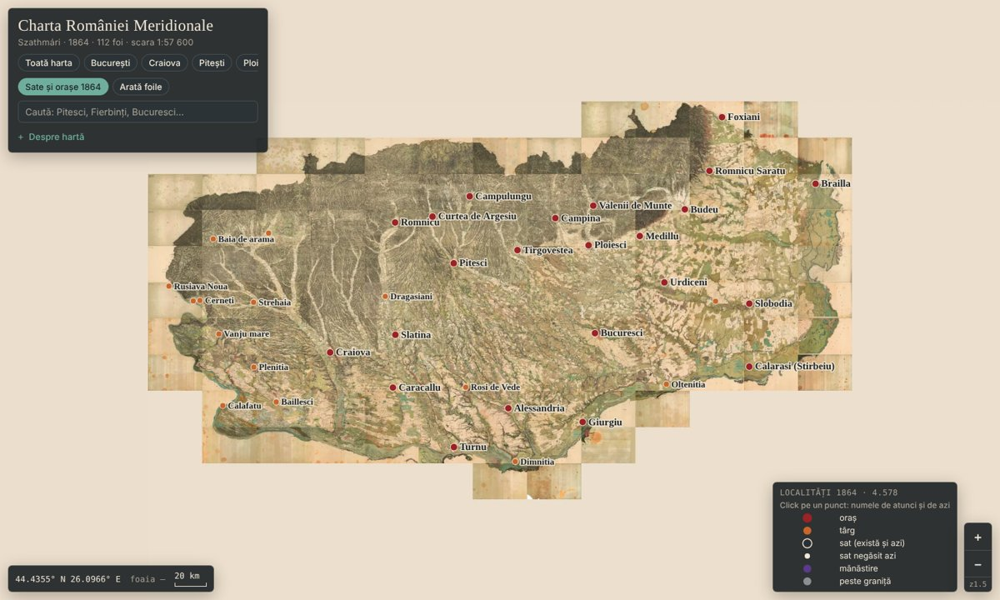

# Charta României Meridionale, 1864

Harta lui Carol Popp de Szathmári (scara 1:57 600, 112 foi) — **Țara Românească în 1864**, îmbinată într-o singură hartă cu zoom, la rezoluția scanărilor originale (~5 m pe pixel).

**Vezi harta:** https://iliemihai.github.io/harta-1864/

## Ce conține
- **Harta întreagă**: toate cele 112 foi (Columna I–XIII × Seria 1–11), tăiate pe chenarul lor și puse cap la cap, cu culorile egalizate.
- **4.578 de localități din 1864**: orașe, târguri, sate și mănăstiri, citite de pe foi, cu căutare după numele de atunci sau de azi. Pentru ~2.400 dintre ele este dat și numele de azi.
- **Coordonate reale**: harta e georeferențiată pe 31 de orașe (abatere medie ~0,6 km). Sub mouse se văd latitudinea și longitudinea.

## Date
| Fișier | Ce e |
|---|---|
| [`date/localitati_1864.csv`](date/localitati_1864.csv) | localitățile: numele din 1864, tipul, foaia, coordonatele pe harta 1864, numele de azi, coordonatele de azi, cât de sigură e potrivirea |
| [`date/harta_1864_google_earth.kmz`](date/harta_1864_google_earth.kmz) | harta peste globul din Google Earth (rezoluție redusă) |
| [`date/georef_1864.json`](date/georef_1864.json) | transformarea pixeli → coordonate (polinom de gradul 2) |

## Note
- Unele foi sunt mai gri, altele mai maro, pentru că provin din exemplare diferite ale hărții, păstrate la Budapesta, Cluj-Napoca și Viena.
- Numele localităților sunt scrise ca pe hartă, cu ortografia de atunci (de ex. *Bucuresci*, *Pitesci*, *Budeu* = Buzău, *Foxiani* = Focșani).
- Potrivirea cu numele de azi e automată (după ortografie și distanță). Cele marcate „probabilă” trebuie verificate. Satele negăsite azi pot fi dispărute, contopite, redenumite sau citite imperfect.
- Harta originală (1864) este în domeniul public.

Plăcile hărții sunt în `t/{z}/{x}_{y}.webp` (z0–z7, plăci de 919×614 px, grila foilor lui Szathmári). Vizualizatorul folosește [Leaflet](https://leafletjs.com).
